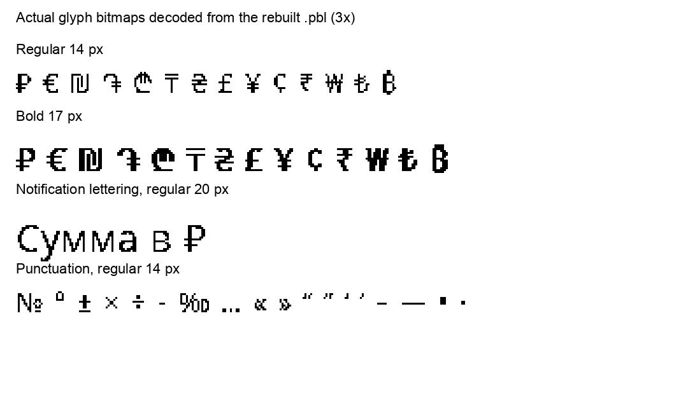

# pebble-polyglot-en-ru-he

A **language pack for the Pebble Time 2** (and other modern Pebble watches) that adds
**Russian (Cyrillic)** and **Hebrew** letters on top of the built-in English — so text in
those languages shows real letters instead of boxes (`□□□`).

A ready-to-install pack is included: **`pebble-EN-RU-HE.pbl`**.

The rebuilt **`pebble-EN-RU-HE-symbols.pbl`** adds the ruble sign and selected
currency/notification symbols. The original pack is retained for rollback.

## Added symbols

The ruble sign `₽` is U+20BD, outside the original Cyrillic and Hebrew ranges.
The bundled TTF already contains its glyph; it was excluded during building.

- Currencies: `₽ € ₪ ₴ ₸ ₾ ֏ £ ¥ ¢ ₹ ₩ ₺ ₿`.
- Numbers and calculations: `№ ° ± × ÷ − ‰`.
- Punctuation: `… « » “ ” ‘ ’ – — • ·`.
- Amount separators: U+00A0 no-break space, U+202F narrow no-break space,
  and U+2009 thin space. Font coverage does not itself change firmware line wrapping.

These are 35 selected characters (ellipsis was already included automatically).
Selection is in `lang/symbols.txt`, with the three spaces in `lang/unicodes.json`
because the builder strips whitespace from text-file lines. Arrows, checkmarks,
and emoji are outside this change; the source font lacks several such symbols.

Binary verification checks all 18 font variants, pack/resource CRCs, unchanged
metadata, and byte-identical glyphs for every character in the original pack.
The new pack has **not yet been tested on a physical Pebble Time 2**.



## What's in here

| File | What it is |
|------|-----------|
| `pebble-EN-RU-HE.pbl` | ⭐ the ready-to-install pack (English + Russian + Hebrew glyphs) |
| `lang/` | build configuration — which scripts and font sizes |
| `ttf/GoNotoKurrent-Regular.ttf` | source font (SIL OFL 1.1) |
| `OFL.txt` | the font's license |

## Install on the watch

1. Copy `pebble-EN-RU-HE-symbols.pbl` to your **Android phone** (USB / Drive / email).
2. Tap it → **open with the Pebble app** → confirm.
3. It **replaces** the currently-loaded language pack (the watch holds one at a time).
   English menus stay; Russian and Hebrew now render.

The upstream author reports the original pack working on a real Pebble Time 2.
After installing the symbols pack, send a test notification such as:

```text
Оплата: 240,00 ₽. Остаток: 5 211,78 ₽.
Валюты: € ₪ ֏ ₾ ₸ ₴ £ ¥ ₹ ₺ ₿
№ 123 — «Проверка»… −5 °C ±2
```

Check the title and body with each notification text size you use. Reinstall
`pebble-EN-RU-HE.pbl` to return to the exact previous pack.

## ⚠️ Hebrew reads right-to-left — the watch doesn't

Pebble's firmware has no right-to-left support, so:

| Setup | Hebrew |
|-------|--------|
| `.pbl` + official Pebble app | letters appear, but **reversed** |
| `.pbl` + [Gadgetbridge](https://gadgetbridge.org/) (RTL Support on) | reads **correctly** |

Gadgetbridge (Android) reverses Hebrew before sending so it reads properly. Russian and
English are unaffected (they're left-to-right).

## Revert (safe)

A language pack replaces font/translation data. To undo: switch the
watch language back to English, or reinstall your previous pack.

## Rebuild

This repo ships the ready-to-use pack and the source config, but **not the build tool**
(it's GPL-licensed — kept separate). To rebuild:

Run from this repository (Python 3.10+ and Git):

```bash
python3 -m venv .venv
.venv/bin/python -m pip install -r requirements.txt
git clone https://github.com/Pyxzure/pebble-lang-gen .build-tools/pebble-lang-gen
git -C .build-tools/pebble-lang-gen checkout b0c05f6f9185ded7d9d50d6df91caf506e7ae792
.venv/bin/python scripts/build_pack.py --builder .build-tools/pebble-lang-gen
```

Output: `pebble-EN-RU-HE-symbols.pbl`. The wrapper builds in a temporary directory,
uses this repository's font/configuration, preserves the original pack's English
metadata, and verifies the binary before copying it into place. It does not modify
the builder checkout or replace the original pack. Keep the original `.pbl` available
because it is the metadata source and regression baseline.

**Pin the builder revision.** This revision reproduces all 19 original resources
byte-for-byte with `freetype-py==2.5.1`. Newer builder `main` adds two Gothic 36
resources and shifts subsequent resource IDs. Using it with this repository's old
numbered font configuration would change font alignment/resource meanings.
This rebuild deliberately preserves the original pack's 18-font resource layout.

Verify an existing output independently:

```bash
.venv/bin/python scripts/verify_pack.py pebble-EN-RU-HE-symbols.pbl --builder .build-tools/pebble-lang-gen
```

For additional symbols, add characters supported by the TTF to `lang/symbols.txt`
and extend `SYMBOLS` in `scripts/verify_pack.py`, then rebuild. The builder silently
skips characters absent from the TTF; verification makes those omissions fail.
The pack timestamp changes on each rebuild, so whole-file SHA-256 can differ even
when font resources are identical.

Scripts are configured in `lang/unicodes.json`:

- Cyrillic `0400`–`04FF` (Russian)
- Hebrew `0590`–`05FF`

Add another Unicode block there to support more scripts — the bundled Go Noto Kurrent font
covers a wide range.

## Credits & license

- **Font:** [Go Noto Kurrent](https://github.com/satbyy/go-noto-universal) (Google Noto),
  **SIL Open Font License 1.1** — see `OFL.txt`. The included `.pbl` contains glyphs rendered
  from this font.
- **Build tool:** [pebble-lang-gen](https://github.com/Pyxzure/pebble-lang-gen) (GPL-3.0) —
  not bundled here; clone it to rebuild.
- The configuration in this repo is provided as-is for personal use; add your own `LICENSE`
  if you want to set explicit terms for it.
